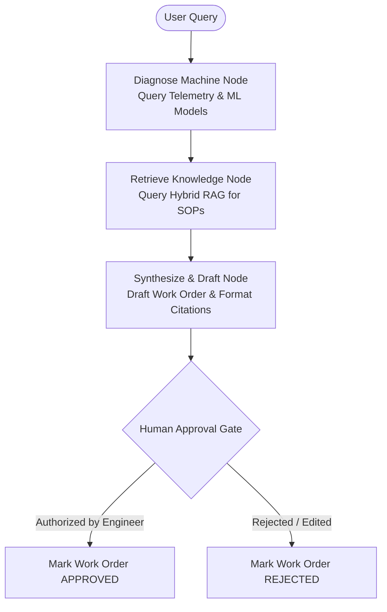

# FactoryPulse: LangGraph Maintenance Agent Specification

## 1. Agent Architecture

The MaintenAIMaintenance Copilot is built on **LangGraph**, enforcing strict deterministic tool execution and Human-in-the-Loop safety boundaries.

## 2. Deterministic Tools
- `get_machine_telemetry(machine_id)`: Fetches verified physical sensor readings.
- `get_ml_health_assessment(machine_id)`: Queries deterministic ML models for Anomaly score, RUL cycles, and Failure modes.
- `search_maintenance_manuals(query, equipment_type)`: Executes Hybrid RAG search over official manuals.
- `draft_work_order(...)`: Generates structured draft work order requiring human authorization.

## 3. Human-in-the-Loop Safety Boundaries
1. **No Hallucinated Numbers**: Sensor values and RUL numbers must strictly come from ML model inference.
2. **Mandatory Citations**: Repair steps must cite manual source files.
3. **Approval Requirement**: No maintenance action can be marked executable without explicit human authorization.
