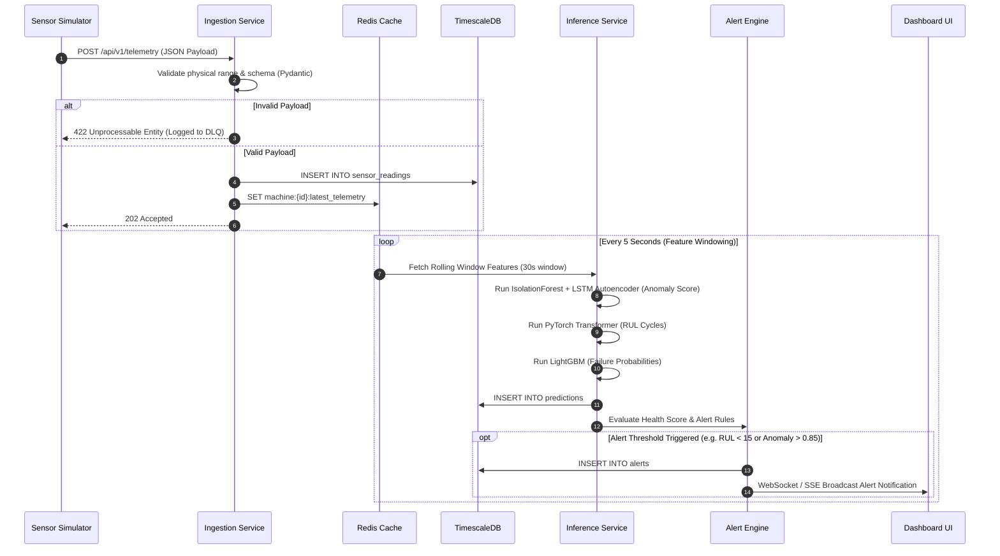
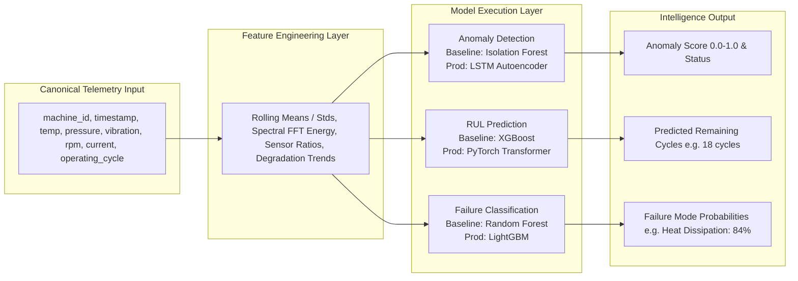
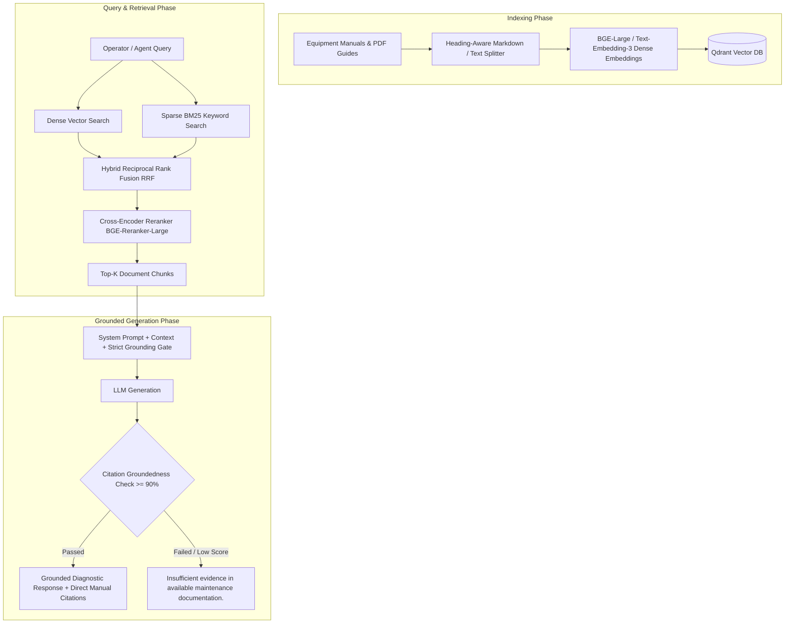
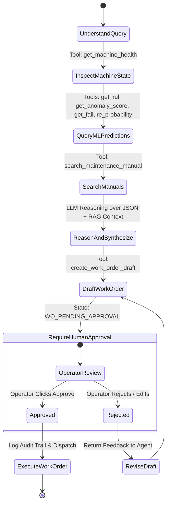
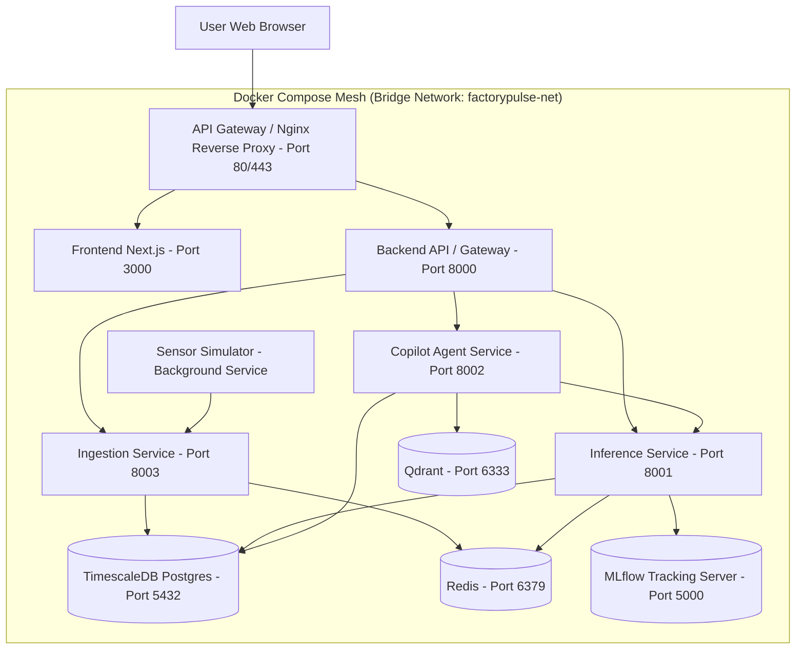

# FactoryPulse: System Architecture & Design Specification

## Executive Summary & Architecture Principles

MaintenAIis an end-to-end industrial predictive maintenance and equipment intelligence platform. It bridges continuous physical machine telemetry with deterministic machine learning, deep learning time-series models, vector-backed retrieval-augmented generation (RAG), and human-in-the-loop agentic AI workflows.

### Core AI Engineering Principle

MaintenAIstrictly enforces a unidirectional, deterministic-first AI engineering pipeline:

```
DATA 
  → FEATURES 
  → ML MODEL 
  → EVALUATION 
  → MODEL REGISTRY 
  → INFERENCE 
  → REAL-TIME DECISION 
  → RAG 
  → AGENT 
  → HUMAN APPROVAL 
  → ACTION
```

#### Strict Separation of Responsibilities
- **Deterministic & ML Models** produce factual machine intelligence: calculating Remaining Useful Life (RUL), anomaly scores, sensor statistics, and failure mode probabilities.
- **LLMs and Agents** strictly DO NOT calculate RUL, compute sensor statistics, generate fake telemetry, or decide statistical anomaly boundaries.
- **RAG + LangGraph Agent Layer** acts solely as an orchestrator and explainer: retrieving grounded maintenance manuals, translating ML metrics into readable diagnoses, drafting work orders, and seeking human authorization before execution.

---

## 1. System Architecture

```mermaid
graph TD
    subgraph "Edge / Simulation"
        SIM[Sensor Simulator Service]
    end

    subgraph "Ingestion & Storage"
        ING[Ingestion Service FastAPI]
        TSDB[(TimescaleDB Time-Series DB)]
        REDIS[(Redis Cache / Feature Store)]
    end

    subgraph "Feature & ML Pipelines"
        FP[Feature Pipeline Service]
        DVC[DVC Data Versioning]
        MLFLOW[MLflow Model Registry]
        ANOM[Anomaly Detection Model<br/>Isolation Forest (Active) / LSTM Autoencoder]
        RUL[RUL Prediction Model<br/>HistGradientBoosting (Active Fallback) / Transformer]
        FAIL[Failure Classifier<br/>HistGradientBoosting (Active Fallback)]
    end

    subgraph "Serving & Alerting"
        INF[Inference Service FastAPI]
        ALERT[Alert Engine Service]
    end

    subgraph "Knowledge & Agentic AI"
        QDRANT[(Qdrant Vector DB)]
        RAG[RAG Knowledge Pipeline]
        AGENT[LangGraph Maintenance Agent]
        LLM[LLM Service / OpenRouter / Ollama / Gemini]
    end

    subgraph "Control & Interface"
        GW[API Gateway / Auth Middleware]
        FE[Operations Dashboard Next.js / React]
        HUMAN[Human Technician / Engineer]
    end

    SIM -->|HTTP / MQTT Telemetry| ING
    ING -->|Validate & Write Telemetry| TSDB
    ING -->|Cache Latest Machine State| REDIS
    TSDB -->|Raw Telemetry| FP
    FP -->|Calculated Features| REDIS
    FP -->|Training Datasets| DVC
    
    DVC --> ANOM & RUL & FAIL
    ANOM & RUL & FAIL -->|Log Artifacts & Metrics| MLFLOW
    MLFLOW -->|Load Production Weights| INF

    REDIS -->|Online Features| INF
    TSDB -->|Historical Windows| INF
    INF -->|Machine Health Scores| ALERT
    INF -->|Predictions API| GW

    ALERT -->|Trigger Alerts| GW
    GW --> FE

    FE -->|Copilot Query / Work Order Request| AGENT
    AGENT -->|1. Get Machine Health| INF
    AGENT -->|2. Search Maintenance Manuals| RAG
    RAG -->|Vector Search & Rerank| QDRANT
    AGENT -->|3. Reason over Evidence| LLM
    AGENT -->|4. Create Work Order Draft| FE

    FE -->|5. Review / Edit / Approve| HUMAN
    HUMAN -->|6. Execute Approved Work Order| TSDB
```

---

## 2. Component Responsibilities

| Component | Technology | Primary Responsibility |
| :--- | :--- | :--- |
| **Sensor Simulator** | Python, Asyncio | Replays historical C-MAPSS, IMS, and AI4I dataset streams with adjustable rates, sensor noise, degradation trajectories, and fault injections. |
| **Ingestion Service** | FastAPI, Pydantic | Ingests real-time machine telemetry, validates schemas and physical ranges, rejects malformed payloads, and writes clean data. |
| **TimescaleDB** | PostgreSQL + TimescaleDB Extension | Primary persistent store for time-series sensor telemetry, alert history, prediction audit logs, and work orders. |
| **Redis** | Redis 7.x | Low-latency key-value store for online sliding window feature caching, real-time machine state, and active session tokens. |
| **Feature Pipeline** | Python, pandas, NumPy, SciPy | Computes temporal sliding windows, rolling stats, exponential moving averages, FFT spectral features, and sensor ratios deterministically. |
| **Inference Service** | FastAPI, PyTorch, XGBoost, LightGBM | Serves model predictions for Anomaly Detection, RUL Estimation, and Failure Mode Classification with p95 < 50ms latency. |
| **Alert Engine** | Python, Celery / Async Worker | Evaluates multi-condition deterministic alert rules with hysteresis and deduplication to prevent alert fatigue. |
| **Qdrant Vector DB** | Qdrant | Stores dense vector embeddings of maintenance manuals, fault-code documentation, and historical maintenance logs. |
| **RAG System** | LangChain / LlamaIndex, SentenceTransformers, BGE-Reranker | Performs hybrid vector and BM25 search over maintenance manuals, reranks context, and enforces strict citation grounding. |
| **LangGraph Maintenance Agent** | LangGraph, LangChain Core | Manages multi-step diagnostic workflows, state persistence, structured tool calling, and human-in-the-loop work order gates. |
| **Operations Console** | Next.js 14, React, TypeScript, Tailwind CSS, Recharts | Interactive web UI for fleet health monitoring, real-time sensor visualization, alert management, and AI Copilot interaction. |
| **MLOps Stack** | DVC, MLflow | Version-controls dataset splits, tracks model hyperparameters and metrics, manages model registry transitions (Staging -> Production). |

---

## 3. Data Flow Architecture



---

## 4. AI & Machine Learning Architecture

MaintenAIincorporates three specialized ML model families trained on canonical dataset schemas derived from benchmark industrial datasets:



### Dataset Mapping & Canonical Schema
1. **NASA C-MAPSS (Turbofan Engine Degradation)**: Used for RUL Prediction. Maps simulated sensor channels (LPC outlet temp, HPC outlet pressure, Fan speed, etc.) into canonical temperature, pressure, RPM, and vibration columns.
2. **NASA IMS Bearing Dataset**: Used for Anomaly Detection. Spectral analysis of vibration accelerometer channels to train spectral energy features and reconstruction autoencoders.
3. **AI4I 2020 Predictive Maintenance Dataset**: Used for Failure-Mode Classification. Multi-label target mapping for Tool Wear Failure (TWF), Heat Dissipation Failure (HDF), Power Failure (PWF), Overstrain Failure (OSF), and Random Failures (RNF).

---

## 5. RAG System Architecture & Workflow



---

## 6. LangGraph Agent & Human-in-the-Loop Workflow



### Approved Agent Tool List
1. `get_machine_health(machine_id: str)`: Returns real-time health score, current telemetry, and status.
2. `get_sensor_history(machine_id: str, window_minutes: int)`: Queries TimescaleDB for historical telemetry trends.
3. `get_anomaly_score(machine_id: str)`: Fetches latest Isolation Forest / LSTM Autoencoder reconstruction score.
4. `get_rul(machine_id: str)`: Fetches latest Transformer RUL point prediction and confidence bounds.
5. `get_failure_probability(machine_id: str)`: Returns failure mode classification probabilities from LightGBM.
6. `search_maintenance_manual(query: str, equipment_type: str)`: Executes hybrid vector search against Qdrant.
7. `search_maintenance_history(machine_id: str)`: Retrieves past maintenance event logs and past work orders.
8. `create_work_order_draft(machine_id: str, issue_summary: str, recommended_actions: List[str], priority: str)`: Submits a pending draft work order to the database awaiting human signature.

---

## 7. Deployment Architecture (Docker & Infrastructure)



---

## 8. Security & RBAC Architecture

### Authentication & Authorization Model
- **Authentication**: Stateless OAuth2 JSON Web Tokens (JWT) signed with HMAC-SHA256 (or RS256 in enterprise SSO mode) containing user identity, active tenant, and role claims.
- **Role-Based Access Control (RBAC)** Matrix:

| Role | View Dashboard & Telemetry | Query AI Copilot | Draft Work Order | Approve Work Order | Manage ML Models & Registry | Administer System & Users |
| :--- | :---: | :---: | :---: | :---: | :---: | :---: |
| **Technician** | ✅ | ✅ | ✅ | ❌ | ❌ | ❌ |
| **Engineer** | ✅ | ✅ | ✅ | ✅ | ✅ | ❌ |
| **Manager** | ✅ | ✅ | ✅ | ✅ | ❌ | ❌ |
| **Admin** | ✅ | ✅ | ✅ | ✅ | ✅ | ✅ |

### Security Safeguards
1. **Prompt Injection Defenses**: Strict instruction-content separation in LLM prompts. User queries and retrieved vector docs are encapsulated in XML tags (`<retrieved_docs>` / `<user_query>`). Document chunks are sanitized to prohibit system prompt overrides or instruction hijacking.
2. **Tool Sandboxing & Allowlisting**: LangGraph agents use static function signatures with explicit Pydantic runtime typing. No arbitrary Python execution (`eval` / `exec`) or unstructured raw database access is permitted.
3. **Audit Logging**: Every sensitive action (model promotion, work order approval, permission change) logs an immutable entry to `audit_logs` in TimescaleDB capturing `user_id`, `action`, `timestamp`, `ip_address`, and `payload_hash`.

---

## 9. Model Lifecycle & MLOps Architecture

```mermaid
graph LR
    subgraph "1. Experimentation & Versioning"
        DATA[Raw Telemetry] -->|DVC Track| DVC_STORE[DVC Remote Store]
        CODE[Feature Code] --> TRAIN[Train Model Pipeline]
        TRAIN -->|Log Params & Metrics| MLF_EXP[MLflow Experiments]
    end

    subgraph "2. Evaluation & Quality Gate"
        MLF_EXP --> EVAL{Evaluation Gate<br/>RMSE <= 20 | F1 >= 0.88}
        EVAL -->|Failed| DISCARD[Discard Candidate]
        EVAL -->|Passed| REG[MLflow Model Registry]
    end

    subgraph "3. Staging & Deployment"
        REG -->|Tag: Staging| SHADOW[Shadow Inference / Canary Run]
        SHADOW --> DRIFT{Drift Check PSI < 0.1}
        DRIFT -->|Pass| PROD[Tag: Production]
        DRIFT -->|Fail| ROLLBACK[Auto-Rollback to Previous Release]
    end

    PROD --> INF_SVC[FastAPI Inference Service]
```

---

## 10. Comprehensive Technology Selection & Trade-Off Analysis

| Technology | Purpose | Alternative | Why Selected | Trade-Off / Risk | Mitigation |
| :--- | :--- | :--- | :--- | :--- | :--- |
| **TimescaleDB** | Time-series telemetry & event storage | Plain PostgreSQL, InfluxDB, Cassandra | Native PostgreSQL compatibility, automated hypertable partitioning, retention policies, combined relational & time-series queries. | Higher operational complexity than standard Postgres; custom extension maintenance. | Standardized Docker setup with automated schema migrations via Alembic. |
| **Redis** | Online feature store & state cache | Memcached, DynamoDB | Sub-millisecond latency for sliding feature windows and active session state; native hash and sorted set data structures. | In-memory volatility; loss of cached features on ungraceful restart. | Warm cache on startup from TimescaleDB historical window queries. |
| **Qdrant** | Vector database for RAG maintenance knowledge | Pinecone, Weaviate, Milvus, pgvector | Lightweight rust-native container, fast HNSW indexing, robust payload filtering by equipment type and fault code. | Self-hosting operational responsibility compared to fully managed SaaS (Pinecone). | Containerized in docker-compose with persistent volume mounts. |
| **LangGraph** | Multi-step agent orchestration & state graphs | LangChain AgentExecutor, AutoGen, CrewAI | Deterministic graph state management, first-class human-in-the-loop pause/resume breakpoints, clean tool loop control. | Steeper learning curve than basic linear chains. | Strict state schema definitions and modular node handler functions. |
| **MLflow** | Experiment tracking & model registry | Weights & Biases, Neptune.ai | Open-source, local/self-hosted deployment, native integration with PyTorch/XGBoost/LightGBM, unified model registry API. | Less feature-rich visualization UI than W&B. | Custom evaluation scripts outputting standardized markdown reports. |
| **DVC (Data Version Control)** | Dataset & pipeline versioning | Git LFS, LakeFS | Git-native tracking of dataset pointers (`.dvc` files), reproducible pipeline execution defined via `dvc.yaml`. | Requires explicit remote storage backend (S3 / Local directory setup). | Local storage backend configured in repository for zero external cloud dependency. |
| **FastAPI** | High-performance asynchronous API backend | Flask, Django REST Framework | Built-in OpenAPI spec generation, Pydantic type validation, native Python `asyncio` for high concurrency ingestion. | Less out-of-the-box admin tooling than Django. | Custom Next.js dashboard UI built specifically for domain workflows. |
| **LightGBM / XGBoost** | Tabular ML (RUL baseline & Failure classification) | Deep Neural Networks (MLP) | Superior efficiency, interpretability (SHAP values), faster training convergence on structured sensor tabular data. | Requires manual time-series feature engineering (rolling windows, spectral features). | Automated feature pipeline module in `ml/features/`. |
| **PyTorch Transformer** | RUL deep learning prediction | LSTM / GRU Networks | Attention mechanisms capture long-range temporal degradation trends better than recurrent architectures. | Higher memory footprint and GPU/CPU inference compute requirement. | Model quantization / ONNX runtime optimization for serving if required. |
| **Next.js 14 / React** | Operations UI & Copilot interface | Vue, Streamlit, Gradio | Enterprise-ready production UI, SSR/SSG capabilities, flexible custom dashboard design and WebSocket support. | Higher frontend complexity than quick Python prototypes (Streamlit). | Modular component library with React Query and Tailwind CSS. |
