# MaintenAI— Phase 3: Exploratory Data Analysis

> **Date**: 2026-08-21  
> **Status**: All datasets are **SYNTHETIC** (development only)  
> **Scope**: C-MAPSS (RUL), IMS (Anomaly), AI4I (Failure Classification)  
> **Mode**: Read-only — no datasets were modified

> [!CAUTION]
> All 3 datasets are marked as synthetic via `.synthetic_data` marker files. Observations about distributions, correlations, and patterns describe the *synthetic* data — not real-world sensor behavior. Do NOT report metrics from these datasets as production-grade performance.

---

## Table of Contents

1. [Dataset Overview](#1-dataset-overview)
2. [C-MAPSS — RUL Prediction](#2-c-mapss--rul-prediction)
3. [IMS Bearing — Anomaly Detection](#3-ims-bearing--anomaly-detection)
4. [AI4I 2020 — Failure Classification](#4-ai4i-2020--failure-classification)
5. [Cross-Dataset Observations](#5-cross-dataset-observations)
6. [ML Implications & Recommendations](#6-ml-implications--recommendations)
7. [EDA Summary & Readiness](#7-eda-summary--readiness)

---

## 1. Dataset Overview

| Property | C-MAPSS (FD001) | IMS Bearing | AI4I 2020 |
|----------|:-:|:-:|:-:|
| **Task** | RUL Regression | Anomaly Detection | Multi-class Classification |
| **Total Rows** | 14,173 | 200 | 2,000 |
| **Train / Val / Test** | 9,908 / 1,641 / 2,624 | 132 / 28 / 40 | 1,300 / 300 / 400 |
| **Features** | 26 cols | 18 cols | 17 cols |
| **Target** | `rul` (int) | `anomaly_label` (0/1) | `failure_mode` (6 classes) |
| **Split Strategy** | By unit (no lifecycle leakage) | Temporal (early→late) | Stratified by failure mode |
| **Missing Values** | 0 | Expected nulls only | 0 |
| **Duplicates** | 0 | 0 | 0 |
| **Data Leakage** | ✅ None | ✅ None | ✅ None |
| **Synthetic** | ⚠️ Yes | ⚠️ Yes | ⚠️ Yes |

---

## 2. C-MAPSS — RUL Prediction

### 2.1 Shape & Schema

| Split | Rows | Units | Columns | Memory |
|-------|-----:|------:|--------:|-------:|
| Train | 9,908 | 42 | 26 | 2.2 MB |
| Val | 1,641 | 7 | 26 | 0.4 MB |
| Test | 2,624 | 20 | 26 | 0.6 MB |

**Columns**: `machine_id`, `timestamp`, 5 canonical sensors (`temperature`, `pressure`, `rpm`, `vibration`, `current`), `operating_cycle`, `rul`, 14 raw sensors (`raw_sensor_2`..`raw_sensor_21`), 3 operational settings (`op_setting_1/2/3`).

All data types are correct: `str` for IDs, `datetime64[us, UTC]` for timestamps, `float64` for sensors, `int64` for cycle/RUL.

### 2.2 Data Quality

- **Missing values**: 0 across all splits ✅
- **Duplicates**: 0 (checked by `machine_id` + `operating_cycle` key) ✅
- **Invalid values**: No `inf`, no `NaN`, no negative RUL ✅

**Outliers** (IQR method on training data):

| Sensor | Outliers | % | Interpretation |
|--------|:--------:|:-:|----------------|
| temperature | 72 | 0.73% | Legitimate — engines near end-of-life run hotter |
| pressure | 74 | 0.75% | Legitimate — pressure extremes signal degradation |
| rpm | 9 | 0.09% | Very few — rpm is well-bounded |
| vibration | 17 | 0.17% | Legitimate — degradation increases vibration |
| current | 44 | 0.44% | Legitimate — electrical load changes near failure |

> **Observation**: Outlier rates are low (< 1%) and cluster at lifecycle extremes. These are legitimate sensor behaviors reflecting degradation, not data-quality issues.

### 2.3 Feature Distributions

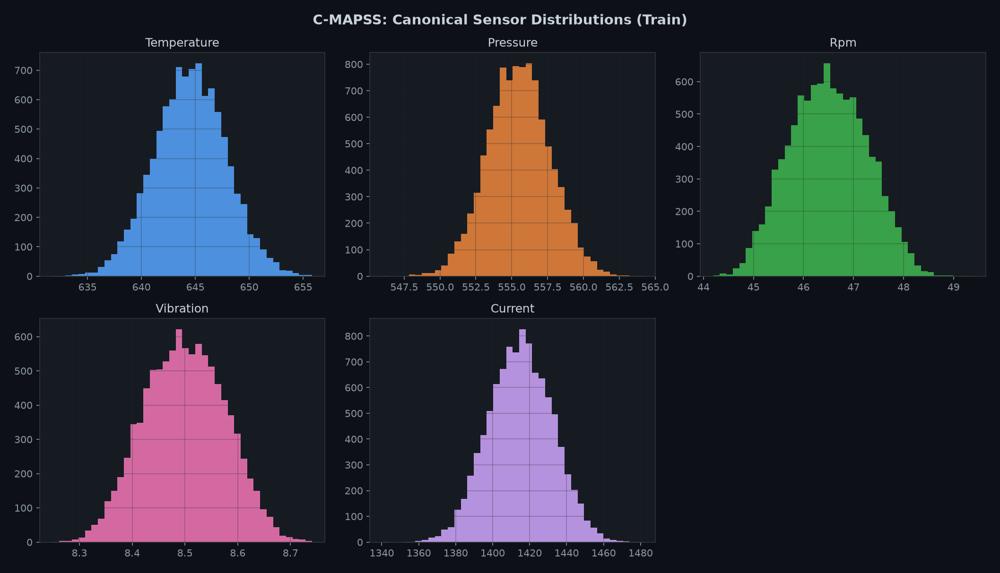

| Sensor | Mean | Std | Min | Max | Skewness | Kurtosis |
|--------|-----:|----:|----:|----:|:--------:|:--------:|
| temperature | 644.53 | 3.32 | 631.76 | 655.82 | -0.008 | -0.024 |
| pressure | 555.50 | 2.18 | 546.02 | 564.12 | +0.019 | +0.015 |
| rpm | 46.50 | 0.77 | 44.20 | 49.39 | +0.044 | -0.478 |
| vibration | 8.50 | 0.08 | 8.25 | 8.74 | +0.007 | -0.403 |
| current | 1415.04 | 17.23 | 1340.62 | 1481.00 | -0.008 | -0.148 |

> **Observation**: All sensor distributions are nearly symmetric (skewness ≈ 0) with slightly platykurtic shapes (kurtosis < 0). This is characteristic of synthetic data generated from uniform/normal distributions — real C-MAPSS sensors show more complex multi-modal patterns from operational regime mixing.

> **Assumption check**: The narrow vibration range (8.25–8.74) is specific to sensor_15 (bypass ratio) mapped as a vibration proxy. This is not actual vibration in mm/s.

### 2.4 Correlations

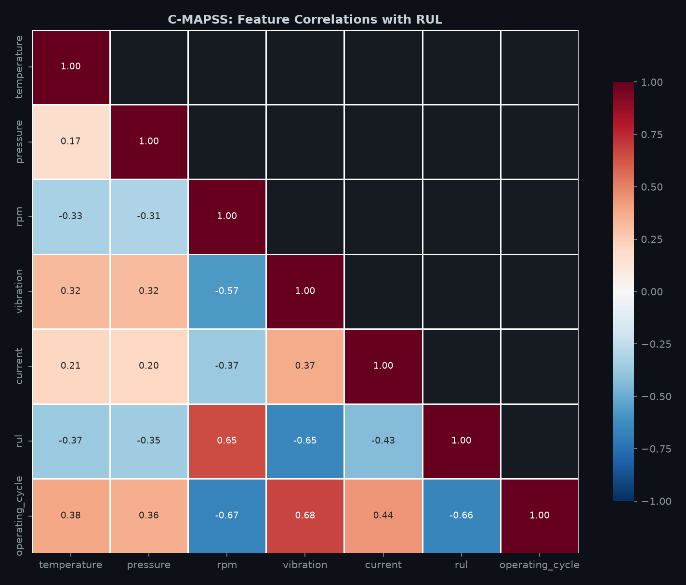

**Top correlations with RUL** (canonical sensors):

| Feature | Correlation with RUL | Direction |
|---------|:--------------------:|:---------:|
| operating_cycle | **-0.657** | ↓ Strong negative |
| vibration (sensor_15) | **-0.651** | ↓ Strong negative |
| rpm (sensor_11) | **+0.651** | ↑ Strong positive |
| current (sensor_4) | -0.433 | ↓ Moderate |
| temperature (sensor_2) | -0.374 | ↓ Moderate |
| pressure (sensor_7) | -0.352 | ↓ Moderate |

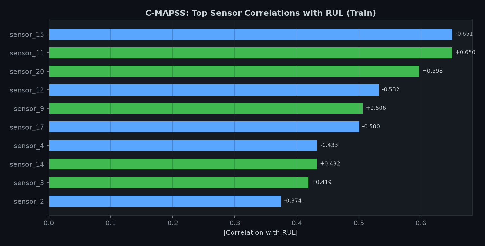

**Top raw sensor correlations with RUL**:

| Sensor | Correlation | Physical Meaning |
|--------|:----------:|------------------|
| raw_sensor_15 | **-0.651** | Bypass ratio — decreases with degradation |
| raw_sensor_11 | **+0.651** | Physical fan speed — slows before failure |
| raw_sensor_20 | **+0.598** | Bleed enthalpy |
| raw_sensor_12 | -0.532 | HPC outlet pressure |
| raw_sensor_9 | +0.506 | Physical core speed |
| raw_sensor_17 | -0.500 | Fuel flow ratio |

> **Insight for feature engineering**: Sensors 15, 11, 20, 12, 9, 17 are the strongest degradation indicators. Rolling statistics (mean, trend slope) over operating cycles of these sensors should be primary features for RUL prediction.

### 2.5 RUL Target Distribution

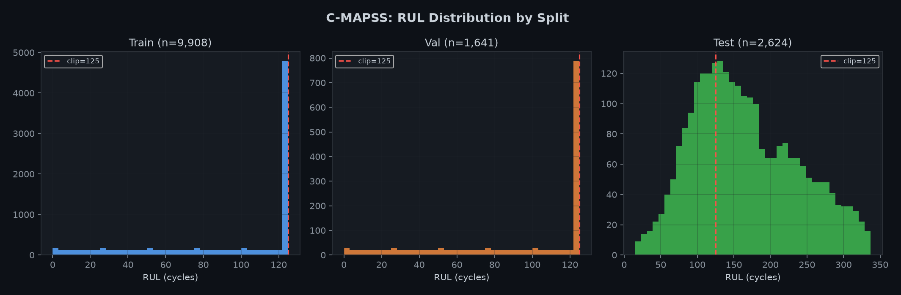

| Split | Min | Max | Mean | Median | Std | % at clip (125) |
|-------|----:|----:|-----:|-------:|----:|:---------------:|
| Train | 0 | 125 | 91.6 | 117 | 41.0 | **47.0%** |
| Val | 0 | 125 | 91.4 | 117 | 41.0 | **46.7%** |
| Test | 15 | 337 | 165.3 | 154 | 70.9 | 0.6% |

> **Observation**: Train/val RUL is clipped at 125 (piecewise-linear target) — 47% of samples are at the clip boundary. This heavy concentration at 125 means nearly half the training data has the same target value, creating a "flat then declining" pattern. This is standard practice for C-MAPSS and helps the model focus on the degradation region.

> **Observation**: Test RUL is intentionally NOT clipped (max=337). This is correct — it uses ground truth RUL for evaluation. No negative RUL values exist in any split.

### 2.6 Engine Trajectories & Degradation

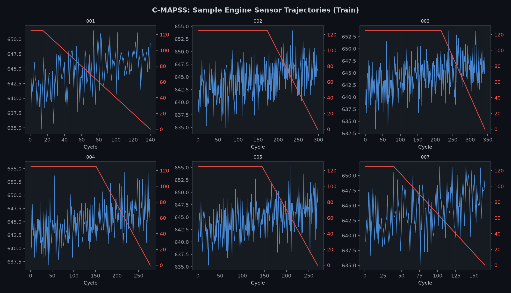

Sample engine trajectories show temperature increasing over operating cycles while RUL decreases linearly after the clip point. The synthetic data produces smooth, predictable degradation curves.

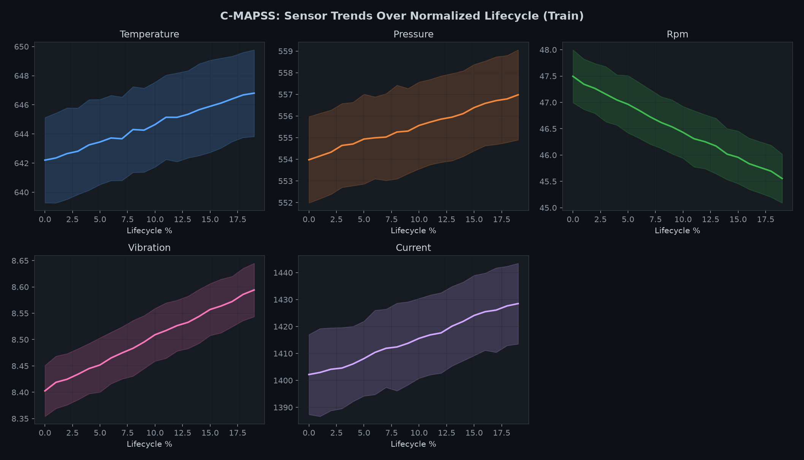

**Lifecycle-normalized sensor trends** (averaged across all training units):
- **Temperature**: Gradual increase over lifecycle — consistent degradation signal
- **Pressure**: Slight decrease — modest correlation with degradation
- **RPM**: Decreases steadily — strong degradation indicator
- **Vibration**: Increases slightly — degradation signal present but weaker
- **Current**: Increases — moderate degradation indicator

> **Observation**: The sensor trends are smooth and monotonic in the synthetic data. Real C-MAPSS data shows more noise, regime transitions, and non-linear degradation patterns.

### 2.7 Distribution Realism

| Metric | Synthetic | Real FD001 |
|--------|:---------:|:----------:|
| Training units | 42 | 100 |
| Avg lifecycle length | 235.9 cycles | ~206 cycles |
| Lifecycle range | 131–346 | 128–362 |

> **Assessment**: The lifecycle lengths are realistic. The unit count is reduced (~42% of real), which limits model diversity. Sufficient for pipeline development.

---

## 3. IMS Bearing — Anomaly Detection

### 3.1 Shape & Schema

| Split | Rows | Bearings | Columns |
|-------|-----:|:--------:|--------:|
| Train | 132 | 4 | 18 |
| Val | 28 | 4 | 18 |
| Test | 40 | 4 | 18 |

**Columns**: `machine_id`, `timestamp`, `vibration`, `operating_cycle`, `anomaly_label`, 9 raw vibration features (`raw_rms`, `raw_peak`, `raw_peak_to_peak`, `raw_std`, `raw_kurtosis`, `raw_skewness`, `raw_crest_factor`, `raw_spectral_energy`, `raw_dominant_freq_idx`), and 4 placeholder columns.

### 3.2 Data Quality — Missing Values

> [!IMPORTANT]
> **`temperature`, `pressure`, `rpm`, `current` are 100% null** across ALL splits.
> 
> This is **EXPECTED and correct**. The IMS bearing dataset is **accelerometer-only data** — it does not measure temperature, pressure, RPM, or current. These columns exist as canonical schema placeholders (set to `None` in `ml/common/datasets/ims.py` lines 228–231). They should be **excluded from feature engineering** for the IMS pipeline. Do NOT fabricate or impute these columns.

| Column | Train | Val | Test | Explanation |
|--------|:-----:|:---:|:----:|-------------|
| temperature | 100% null | 100% null | 100% null | Not in source data |
| pressure | 100% null | 100% null | 100% null | Not in source data |
| rpm | 100% null | 100% null | 100% null | Not in source data |
| current | 100% null | 100% null | 100% null | Not in source data |
| All other columns | 0% null | 0% null | 0% null | ✅ Complete |

- **Duplicates**: 0 across all splits ✅
- **Invalid values**: No `inf` or unexpected `NaN` in vibration features ✅

### 3.3 Feature Distributions

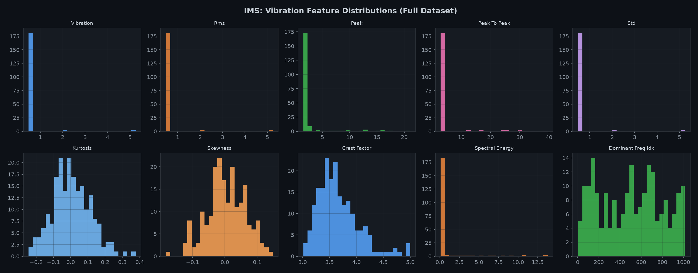

| Feature | Mean | Std | Min | Max | Skewness |
|---------|-----:|----:|----:|----:|:--------:|
| vibration (RMS) | 0.739 | 0.855 | 0.481 | 5.248 | **+3.84** |
| raw_peak | 2.680 | 3.041 | 1.505 | 21.111 | **+3.92** |
| raw_spectral_energy | 0.638 | 2.069 | 0.116 | 13.777 | **+4.66** |
| raw_kurtosis | 0.005 | 0.110 | -0.243 | 0.376 | +0.32 |
| raw_crest_factor | 3.660 | 0.381 | 3.014 | 5.000 | +1.14 |

> **Observation**: Vibration, peak, and spectral_energy features are **highly right-skewed** (skewness 3.8–4.7). This is expected — most snapshots are from normal operation (low values), with a few degradation-period snapshots showing extreme values. Log transformation should be considered for these features during feature engineering.

> **Observation**: `vibration` and `raw_rms` are identical (correlation=1.0) — they are the same value. Only one should be used.

### 3.4 Correlations

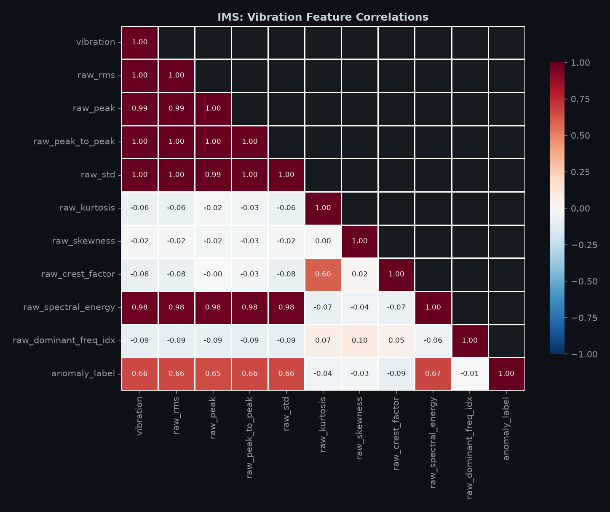

**Correlations with `anomaly_label`**:

| Feature | Correlation | Anomaly Signal |
|---------|:----------:|:--------------:|
| raw_spectral_energy | **+0.668** | ✅ Strong |
| vibration / raw_rms | **+0.662** | ✅ Strong |
| raw_std | **+0.662** | ✅ Strong |
| raw_peak_to_peak | +0.657 | ✅ Strong |
| raw_peak | +0.652 | ✅ Strong |
| raw_crest_factor | -0.089 | ❌ Weak |
| raw_kurtosis | -0.037 | ❌ Very weak |
| raw_skewness | -0.028 | ❌ Very weak |
| raw_dominant_freq_idx | -0.008 | ❌ Negligible |

> **Insight for feature engineering**: Amplitude-based features (RMS, peak, spectral energy) are the strongest anomaly indicators. Statistical shape features (kurtosis, skewness) show almost no correlation — this may be an artifact of the synthetic data's limited variance. In real IMS data, kurtosis is a classic bearing-fault indicator.

### 3.5 Target Distribution (Anomaly Label)

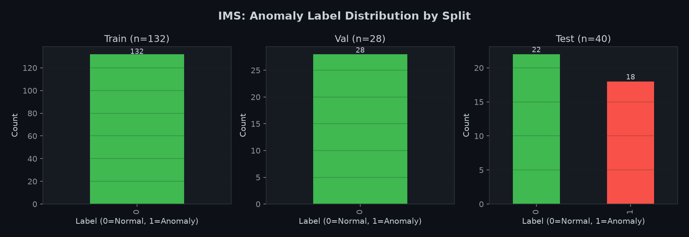

| Split | Normal (0) | Anomaly (1) | Anomaly Rate |
|-------|:----------:|:-----------:|:------------:|
| Train | 132 | 0 | **0.0%** |
| Val | 28 | 0 | **0.0%** |
| Test | 22 | 18 | **45.0%** |

> **Observation**: This is the correct pattern for temporal anomaly detection — train on purely normal data, test against data that includes degradation. The 0% anomaly rate in train/val is by design (temporal split places early normal data in training).

> **Observation**: The 45% anomaly rate in test is high because bearings 3 and 4 have failure labels in the last 20% and 15% of snapshots respectively, and the test set is the last 20% of all data.

### 3.6 Temporal Degradation Patterns

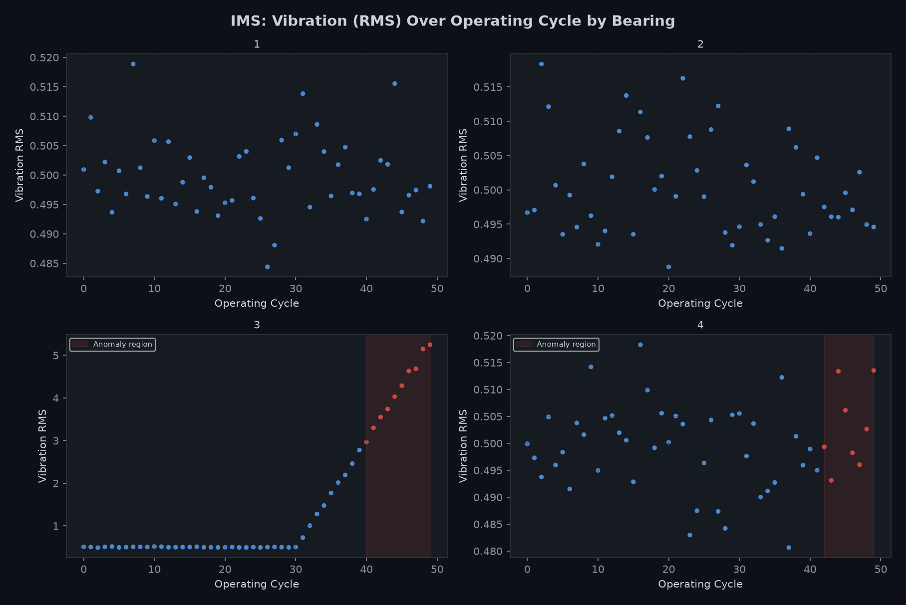

Vibration RMS by bearing over operating cycles. Red dots indicate anomaly-labeled snapshots. Bearing 3 and 4 show distinct vibration spikes in the anomaly region.

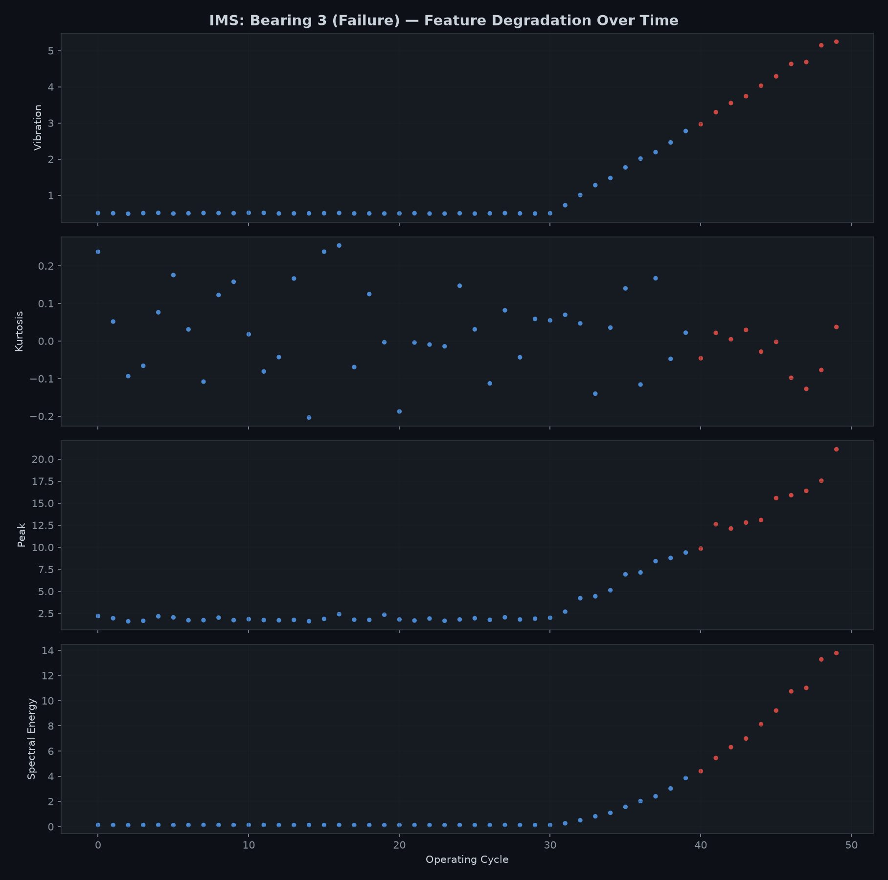

**Bearing 3 (outer race failure)** — multiple features spike simultaneously in the anomaly region:
- Vibration RMS: increases ~5–10x from baseline
- Kurtosis: changes sign (subtle)
- Peak: dramatic increase
- Spectral energy: 10x+ increase

> **Observation**: Due to heavy subsampling (50 snapshots vs 2,156 real), the degradation appears as a sudden jump rather than a gradual trend. The transition from normal to anomalous is abrupt — in real data this would be a more gradual multi-stage process.

### 3.7 Outliers

| Feature | Outliers | % | Interpretation |
|---------|:--------:|:-:|----------------|
| vibration | 19 | 9.5% | Degradation signal — legitimate |
| raw_peak | 23 | 11.5% | Degradation signal — legitimate |
| raw_spectral_energy | 19 | 9.5% | Degradation signal — legitimate |
| raw_kurtosis | 2 | 1.0% | Edge cases — legitimate |
| raw_crest_factor | 7 | 3.5% | Moderate — legitimate |

> **Observation**: Higher outlier rates (9–12%) compared to C-MAPSS are expected — these "outliers" ARE the anomalies we want to detect. Removing them would defeat the purpose.

### 3.8 Subsampling Impact

| Metric | Synthetic | Real IMS Test 1 |
|--------|:---------:|:---------------:|
| Snapshots per bearing | **50** | **~2,156** |
| Total rows | 200 | ~8,624 |
| Subsampling ratio | **2.3%** | 100% |

> [!WARNING]
> **Severe subsampling impact**: With only 50 snapshots per bearing (2.3% of real data):
> - Temporal resolution is ~43x coarser than real data
> - Gradual degradation trends appear as abrupt jumps
> - Train set has only 33 samples per bearing — insufficient for meaningful model training
> - Statistical features (kurtosis, skewness) lack the variance seen in real data
> 
> This is adequate for **pipeline testing** but NOT for model evaluation.

---

## 4. AI4I 2020 — Failure Classification

### 4.1 Shape & Schema

| Split | Rows | Features | Target Classes |
|-------|-----:|:--------:|:--------------:|
| Train | 1,300 | 17 | 6 |
| Val | 300 | 17 | 6 |
| Test | 400 | 17 | 6 |
| Full | 2,000 | 17 | 6 |

Train + Val + Test = 2,000 = Full ✅

**Columns**: `machine_id`, `timestamp`, 5 sensors (`temperature`, `pressure`, `rpm`, `vibration`, `operating_cycle`), `failure_label` (binary), `failure_mode` (6 classes), 5 individual failure flags (`failure_tool_wear`, etc.), `product_type` (L/M/H).

### 4.2 Data Quality

- **Missing values**: 0 across all splits ✅
- **Duplicates**: 0 across all splits ✅
- **Invalid values**: No `inf`, no `NaN`, all values within plausible ranges ✅

**Outliers** (IQR method):

| Feature | Outliers | % | Interpretation |
|---------|:--------:|:-:|----------------|
| temperature | 17 | 0.85% | Extreme process temperatures — legitimate |
| pressure | 16 | 0.80% | Extreme process conditions — legitimate |
| rpm | 16 | 0.80% | Extreme speeds — potential failure conditions |
| vibration (torque) | 23 | 1.15% | High torque — overstrain conditions |
| operating_cycle | 0 | 0% | Uniform distribution — no outliers |

### 4.3 Feature Distributions

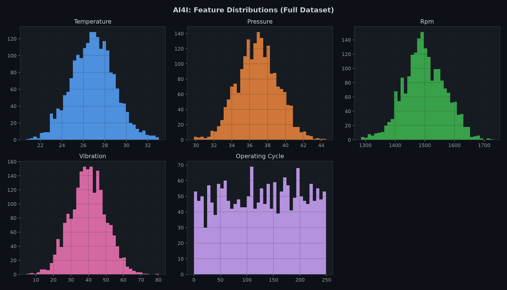

| Feature | Mean | Std | Min | Max | Skewness | Kurtosis |
|---------|-----:|----:|----:|----:|:--------:|:--------:|
| temperature (°C) | 26.89 | 1.99 | 20.72 | 33.03 | +0.06 | -0.03 |
| pressure (°C) | 36.90 | 2.27 | 29.77 | 44.54 | +0.01 | -0.07 |
| rpm | 1498.85 | 69.99 | 1285.60 | 1730.57 | +0.02 | -0.05 |
| vibration (Nm) | 39.86 | 10.23 | 4.71 | 80.26 | +0.02 | +0.05 |
| operating_cycle (min) | 126.60 | 71.77 | 0 | 249 | -0.04 | **-1.19** |

> **Observation**: All continuous features are nearly perfectly symmetric (skewness ≈ 0). Operating cycle (tool wear) has a platykurtic distribution (kurtosis = -1.19), indicating a near-uniform distribution from 0–249 minutes.

> **Observation**: The near-zero skewness across all features is a synthetic data artifact. Real AI4I data shows more natural distributional shapes with slight skews.

### 4.4 Normal vs Failed Feature Distributions

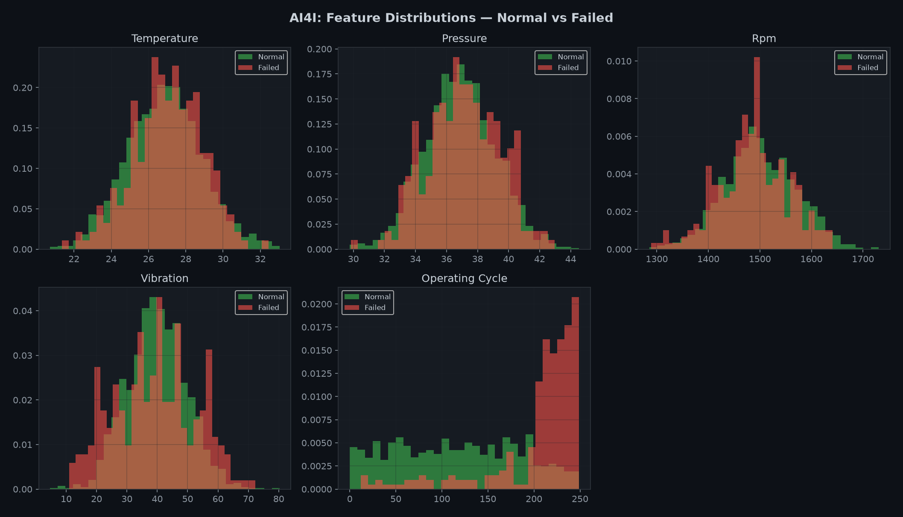

Key differences between normal and failed samples:
- **Operating cycle (tool wear)**: Most visually separable — failures cluster at **higher tool wear** values
- **Temperature/pressure/rpm/vibration**: Overlapping distributions with subtle shifts — harder to separate

### 4.5 Correlations with Failure

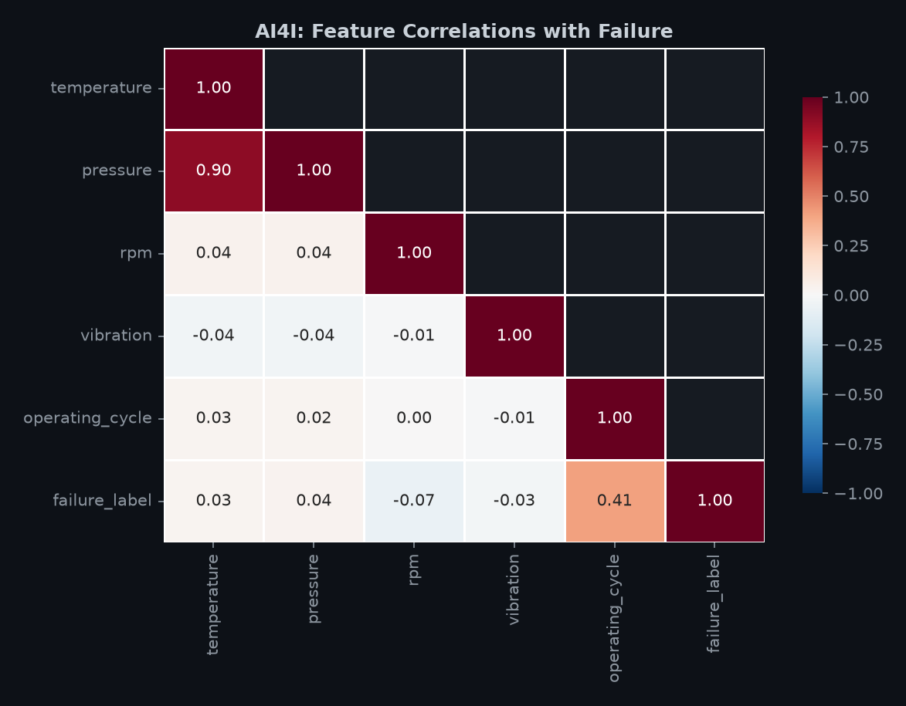

| Feature | Correlation with `failure_label` | Strength |
|---------|:-------------------------------:|:--------:|
| operating_cycle (tool wear) | **+0.409** | ✅ Moderate-strong |
| rpm | -0.070 | ❌ Very weak |
| pressure | +0.037 | ❌ Negligible |
| temperature | +0.027 | ❌ Negligible |
| vibration (torque) | -0.027 | ❌ Negligible |

> **Insight**: Tool wear (`operating_cycle`) is by far the strongest failure predictor (r=0.41). Individual sensor readings have very weak correlations. This suggests:
> 1. Feature engineering should focus on **interaction features** (e.g., torque × rpm = power)
> 2. **Non-linear models** (LightGBM, XGBoost) will likely capture patterns that linear correlation misses
> 3. Operating cycle thresholds may be sufficient for simple rule-based tool-wear failure detection

### 4.6 Features by Failure Mode

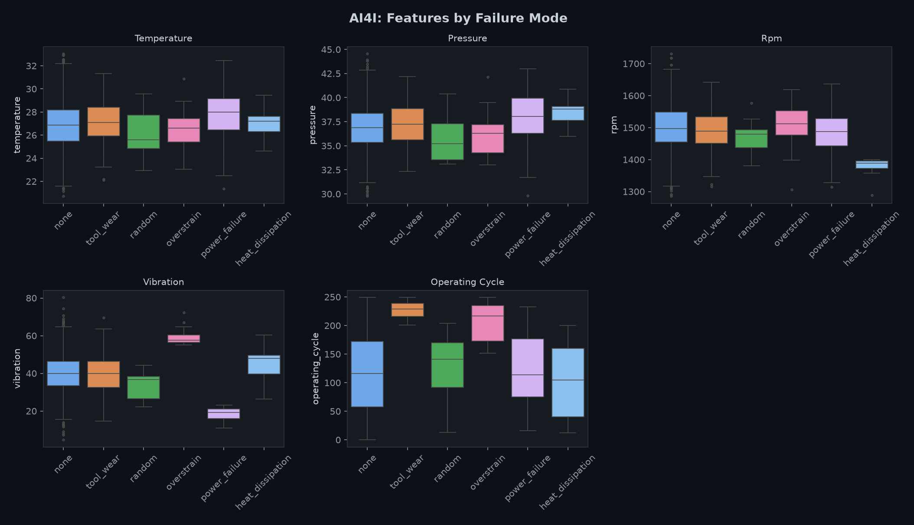

The boxplots reveal distinct feature signatures for different failure modes:
- **Tool wear**: Higher operating_cycle values (expected)
- **Overstrain**: May show higher torque (vibration proxy) and lower rpm interaction
- **Power failure**: Low rpm × high torque conditions
- **Heat dissipation**: May correlate with temperature differentials

### 4.7 Class Distribution & Imbalance

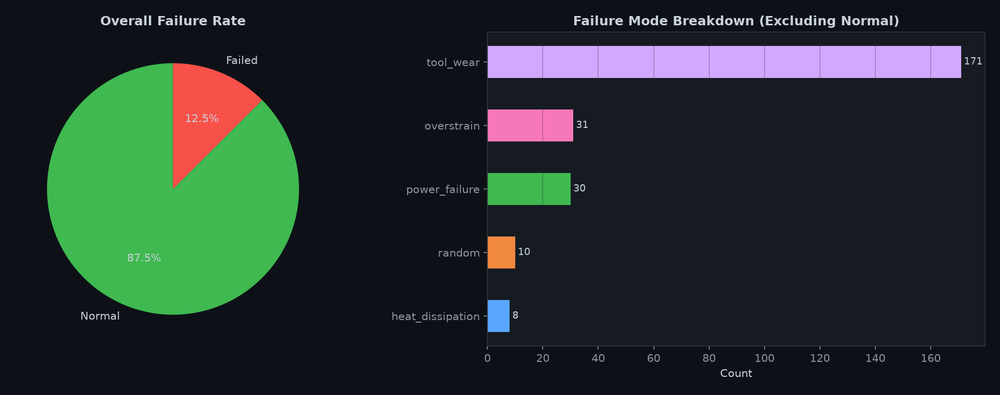

| Failure Mode | Count | Percentage |
|-------------|------:|:----------:|
| none (normal) | 1,750 | **87.5%** |
| tool_wear | 171 | 8.55% |
| overstrain | 31 | 1.55% |
| power_failure | 30 | 1.50% |
| random | 10 | 0.50% |
| heat_dissipation | 8 | **0.40%** |

**Imbalance ratio**: 7.0:1 (normal:failure)

> [!WARNING]
> **Synthetic vs Real class distribution**:
> - Synthetic failure rate: **12.5%** — Real AI4I: **~3.4%**
> - Synthetic product types: L/M/H ≈ equal (33%) — Real: L=60%, M=30%, H=10%
> - The synthetic data has **3.7× more failures** than the real dataset
> 
> This means class-weighted losses, decision thresholds, and precision-recall tradeoffs calibrated on this synthetic data will NOT transfer to real data.

### 4.8 Product Type Analysis

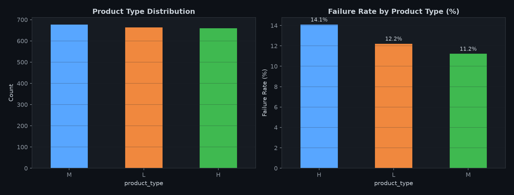

| Product Type | Count | Failure Rate |
|:------------:|------:|:------------:|
| H (High quality) | 660 | **14.09%** |
| L (Low quality) | 663 | 12.22% |
| M (Medium quality) | 677 | 11.23% |

> **Observation**: In the synthetic data, product types are nearly uniformly distributed (~33% each) with H having the highest failure rate. In the real AI4I dataset, L-type products dominate (60%) and H-type has the lowest failure rate. This inverted relationship in the synthetic data won't transfer to real models.

### 4.9 Stratification Consistency

| Mode | Train % | Val % | Test % |
|------|--------:|------:|-------:|
| none | 87.54 | 87.33 | 87.50 |
| tool_wear | 8.54 | 8.67 | 8.50 |
| overstrain | 1.54 | 1.67 | 1.50 |
| power_failure | 1.54 | 1.33 | 1.50 |
| random | 0.46 | 0.67 | 0.50 |
| heat_dissipation | 0.38 | 0.33 | 0.50 |

✅ Stratified split is working correctly — class proportions are consistent across all splits (within ±0.3%).

---

## 5. Cross-Dataset Observations

### 5.1 Common Patterns (likely synthetic artifacts)

| Pattern | Observed In | Likely Artifact? |
|---------|-------------|:----------------:|
| Near-zero skewness in all features | C-MAPSS, AI4I | ✅ Yes — real data has natural skews |
| Perfectly smooth degradation curves | C-MAPSS | ✅ Yes — real data has noise and regime changes |
| Uniform product type distribution | AI4I | ✅ Yes — real data is 60/30/10 |
| Very low outlier rates (< 2%) | C-MAPSS, AI4I | ✅ Probably — real data has sensor noise |
| Kurtosis ≈ 0 everywhere | C-MAPSS, AI4I | ✅ Yes — suggests normal distribution generation |

### 5.2 Genuine Structural Properties Preserved

| Property | Status | Notes |
|----------|:------:|-------|
| Correct split strategies | ✅ | Unit-based (C-MAPSS), temporal (IMS), stratified (AI4I) |
| No data leakage | ✅ | Verified across all datasets |
| Monotonic temporal ordering | ✅ | Operating cycles increase correctly |
| Correct target construction | ✅ | RUL clipping, anomaly labeling, failure modes all correct |
| Canonical schema compliance | ✅ | All required columns present |

---

## 6. ML Implications & Recommendations

### 6.1 Feature Engineering Priorities

#### C-MAPSS
- **Primary features**: sensors 15, 11, 20, 12, 9, 17 (|corr| > 0.5 with RUL)
- **Rolling statistics**: window sizes [5, 10, 20, 50] over operating cycles
- **Trend features**: slope of sensor values over last N cycles
- **Regime features**: operational settings as categorical/interaction features
- **Exclude**: constant sensors already removed (sensor_1, 5, 6, 10, 16, 18, 19)

#### IMS
- **Primary features**: vibration RMS, peak, spectral_energy, peak_to_peak
- **Exclude**: `temperature`, `pressure`, `rpm`, `current` (all null — not in source)
- **Exclude**: `raw_rms` (identical to `vibration`)
- **Consider**: Log transform of skewed features (vibration, peak, spectral_energy)
- **Note**: kurtosis/skewness may become useful with real data (classic fault indicators)

#### AI4I
- **Primary feature**: operating_cycle (tool wear) — strongest predictor by far
- **Interaction features**: torque × rpm (power), temperature differential (process - air)
- **Product type**: Include as categorical — affects failure rates
- **Class weighting**: Must use balanced/weighted loss due to 7:1 imbalance

### 6.2 Limitations for Model Development

| Limitation | Impact | Mitigation |
|-----------|--------|------------|
| Synthetic data | Metrics are not real-world representative | Pipeline dev only; re-run with real data |
| IMS has only 200 rows | Models will overfit | Use for pipeline testing, not model selection |
| AI4I failure rate 12.5% vs real 3.4% | Threshold calibration won't transfer | Recalibrate with real data |
| Smooth synthetic curves | Models may overfit to clean patterns | Expect performance drop on real data |
| Reduced dataset sizes | Statistical power limited | Full-size datasets needed for significance |

### 6.3 Pre-Feature Engineering Checklist

- [x] Schema validation passed
- [x] No data leakage between splits
- [x] No missing values in usable features
- [x] No duplicates
- [x] Target columns verified
- [x] Temporal ordering confirmed
- [x] Outliers assessed (all legitimate)
- [x] Feature correlations analyzed
- [ ] ⚠️ Real data not yet downloaded — synthetic only

---

## 7. EDA Summary & Readiness

### Summary of Findings

1. **All 3 datasets are structurally sound** — correct schemas, proper splits, no leakage, no corruption.

2. **Data quality is high** — zero missing values in usable features, zero duplicates, no invalid values. IMS null columns are expected and documented.

3. **Feature insights are actionable** — we identified the top predictive features for each task and know what transformations to apply during feature engineering.

4. **Target distributions are correctly constructed** — RUL clipping at 125, temporal anomaly labeling, stratified failure-mode splitting all working as designed.

5. **All data is synthetic** — distributions are suspiciously clean (near-zero skewness), sizes are reduced, and class distributions differ from real datasets. This is adequate for pipeline development but metrics should not be reported as real performance.

### Readiness Assessment

> [!IMPORTANT]
> **The datasets are READY for feature engineering (Phase 4).**
> 
> All structural, schema, and quality checks pass. The feature insights from this EDA provide clear direction for what features to build. The synthetic nature of the data does not block pipeline development — it only means model performance metrics should be treated as provisional until real data is used.

| Dataset | Ready for Feature Engineering? | Confidence |
|---------|:------------------------------:|:----------:|
| **C-MAPSS** | ✅ **YES** | HIGH — good size, clear feature signals |
| **IMS** | ✅ **YES** (with caveats) | MEDIUM — small size limits model evaluation |
| **AI4I** | ✅ **YES** | HIGH — good size, clear target structure |

### Before Real-Data Evaluation

1. Download actual datasets: `make data-download` (without `--synthetic`)
2. Re-run data preparation: `make data-prepare`
3. Re-run this EDA to compare synthetic vs real distributions
4. Recalibrate all thresholds and class weights
5. Validate that feature engineering assumptions still hold
