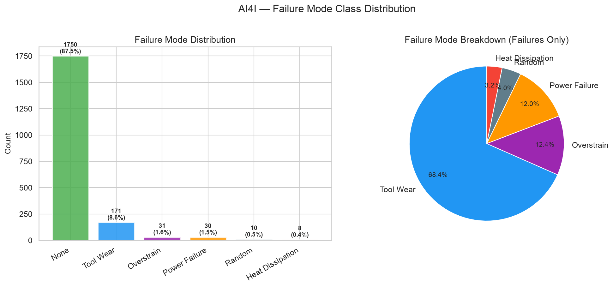
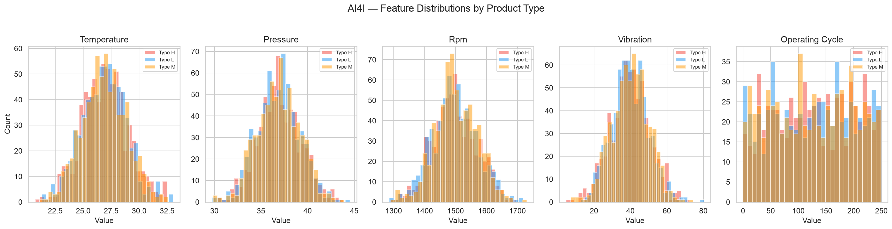
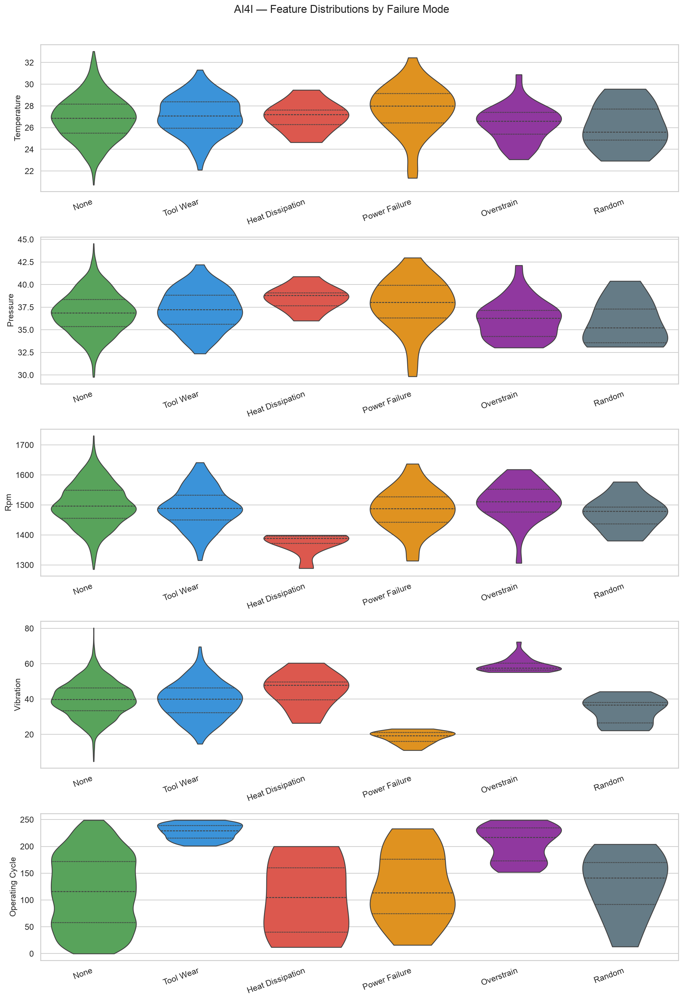
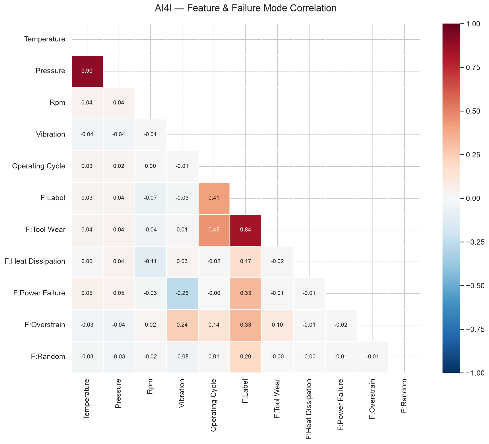
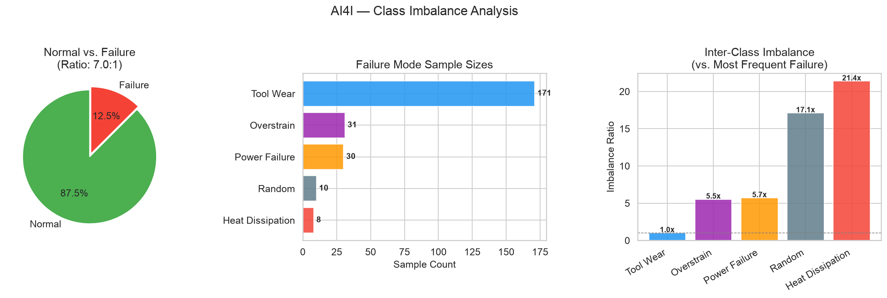

# AI4I 2020 — Exploratory Data Analysis

## Dataset Overview

| Metric | Value |
|--------|-------|
| Total Samples | 2,000 |
| Normal Samples | 1,750 (87.5%) |
| Failure Samples | 250 (12.5%) |
| Imbalance Ratio (Normal:Failure) | 7.0:1 |
| Multi-Label Failures | 13 (0.65%) |

## Product Type Distribution

| Type | Count | Description |
|------|-------|-------------|
| H | 660 (33.0%) | High quality |
| L | 663 (33.1%) | Low quality |
| M | 677 (33.9%) | Medium quality |

## Failure Mode Distribution

| Mode | Count | Percentage |
|------|-------|------------|
| None | 1,750 | 87.5% |
| Tool Wear | 171 | 8.6% |
| Overstrain | 31 | 1.6% |
| Power Failure | 30 | 1.5% |
| Random | 10 | 0.5% |
| Heat Dissipation | 8 | 0.4% |

## Sensor Statistics

| Sensor | Mean | Std | Min | Max |
|--------|------|-----|-----|-----|
| Temperature | 26.89 | 1.99 | 20.72 | 33.03 |
| Pressure | 36.90 | 2.27 | 29.77 | 44.54 |
| Rpm | 1498.85 | 69.99 | 1285.60 | 1730.57 |
| Vibration | 39.86 | 10.23 | 4.71 | 80.26 |
| Operating Cycle | 126.60 | 71.77 | 0.00 | 249.00 |

## Visualizations

### Failure Mode Distribution

### Features by Product Type

### Failure Mode Feature Comparison

### Correlation Heatmap

### Class Imbalance Analysis

## Key Observations

1. **Severe class imbalance**: Normal samples outnumber failures by 7.0:1, requiring SMOTE, class weights, or focal loss during model training.
2. **Tool wear dominance**: Tool wear failure is the most common failure mode, but the failure distribution is heavily skewed — Random failures have very few samples.
3. **Temperature and RPM as discriminators**: These features show the strongest separation between failure modes, making them critical inputs to the classifier.
4. **Product type influence**: Low-quality products (Type L) have different feature distributions from High-quality (Type H), suggesting product type is a useful stratification variable.
5. **Multi-label overlaps**: 13 samples have multiple simultaneous failure modes (0.65%), informing the choice of multi-label vs. priority-based classification strategy.
