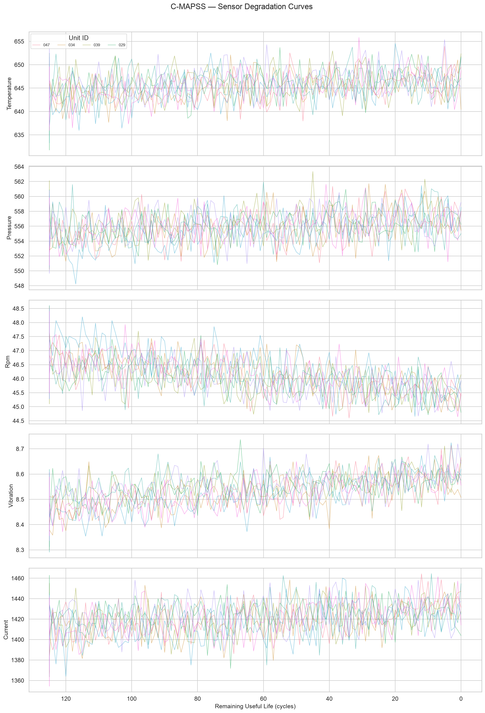
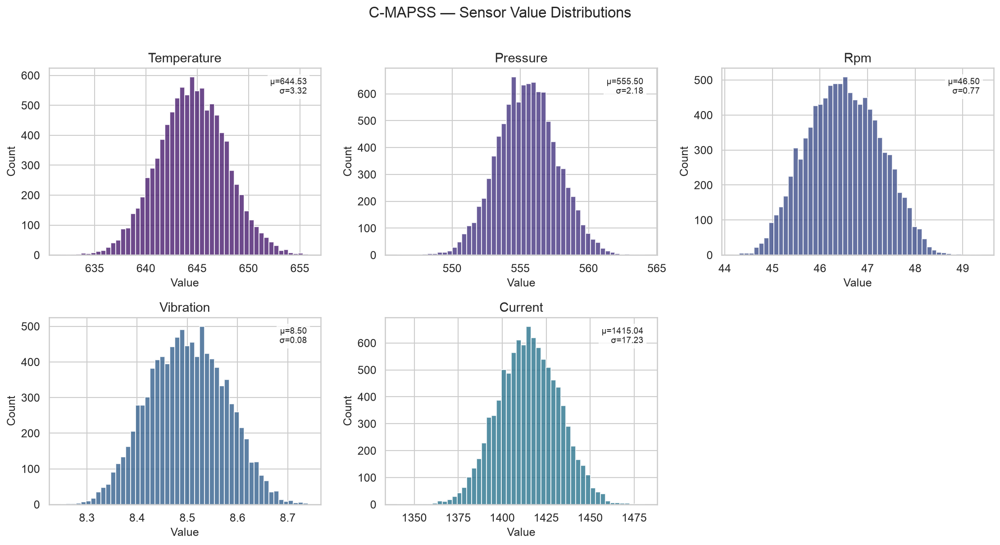
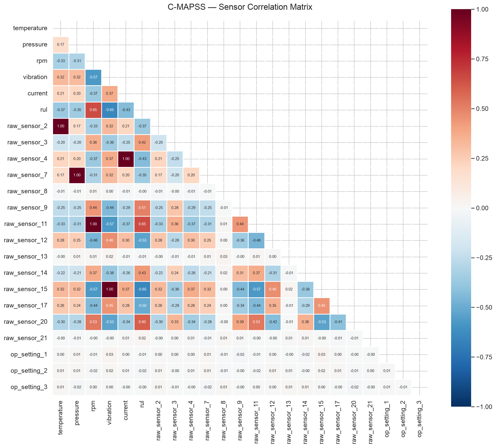
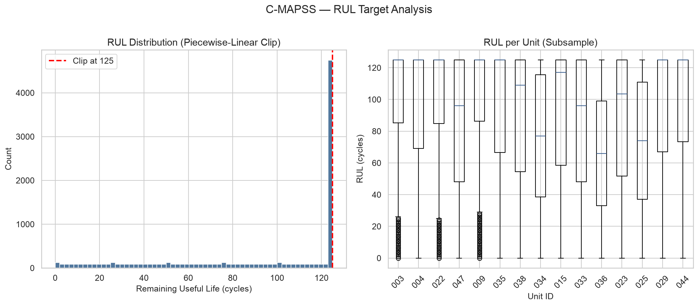
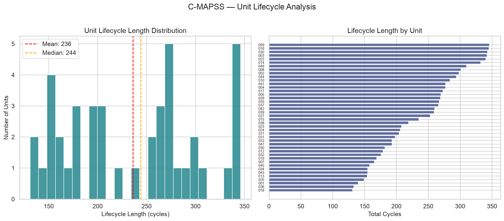

# C-MAPSS (FD001) — Exploratory Data Analysis

## Dataset Overview

| Metric | Value |
|--------|-------|
| Total Rows | 9,908 |
| Total Units | 42 |
| Lifecycle Min / Max | 131 / 346 cycles |
| Lifecycle Mean ± Std | 235.9 ± 67.7 cycles |
| RUL Range | 0 — 125 cycles |
| RUL Mean / Median | 91.6 / 117.0 cycles |

## Sensor Statistics

| Sensor | Mean | Std | Min | Max | Missing % |
|--------|------|-----|-----|-----|-----------|
| Temperature | 644.53 | 3.32 | 631.76 | 655.82 | 0.0% |
| Pressure | 555.50 | 2.18 | 546.02 | 564.12 | 0.0% |
| Rpm | 46.50 | 0.77 | 44.20 | 49.39 | 0.0% |
| Vibration | 8.50 | 0.08 | 8.25 | 8.74 | 0.0% |
| Current | 1415.04 | 17.23 | 1340.62 | 1481.00 | 0.0% |

## Visualizations

### Sensor Degradation Curves

### Sensor Value Distributions

### Correlation Heatmap

### RUL Target Distribution

### Unit Lifecycle Lengths

## Key Observations

1. **Piecewise-linear RUL clip at 125 cycles**: The flat region in the RUL distribution indicates the clip is working correctly — early-life cycles where no degradation has started are capped.
2. **Sensor degradation trends**: Sensors show increasing variance and trend shifts as RUL approaches 0, confirming the degradation signal is present in the data.
3. **Lifecycle variability**: Units have lifecycles ranging from 131 to 346 cycles (mean 236), indicating diverse degradation trajectories suitable for model generalization.
4. **Constant sensors removed**: 7 near-constant sensors (1, 5, 6, 10, 16, 18, 19) were removed during preprocessing to reduce noise.
