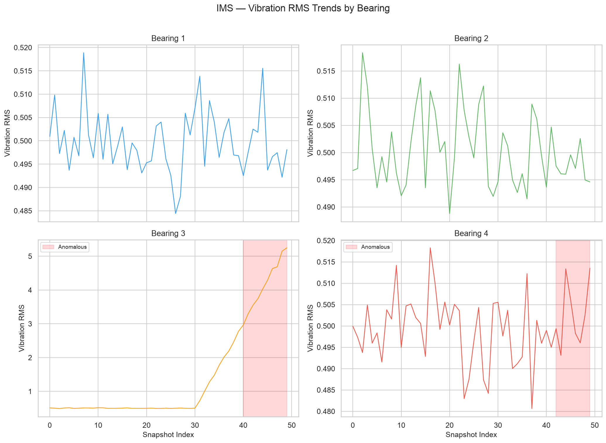
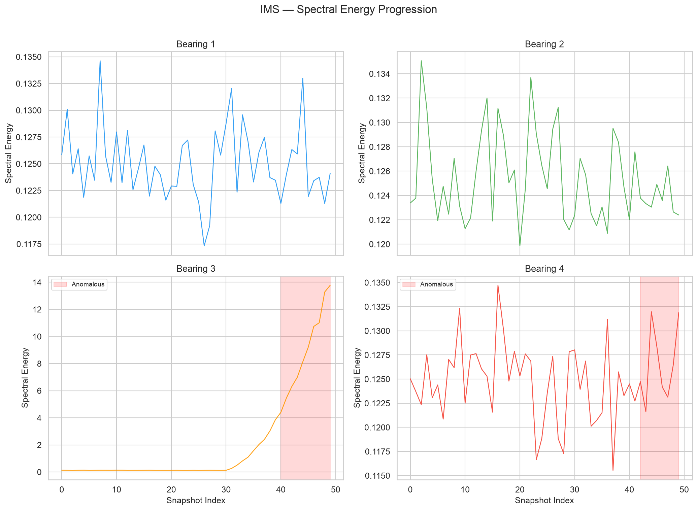
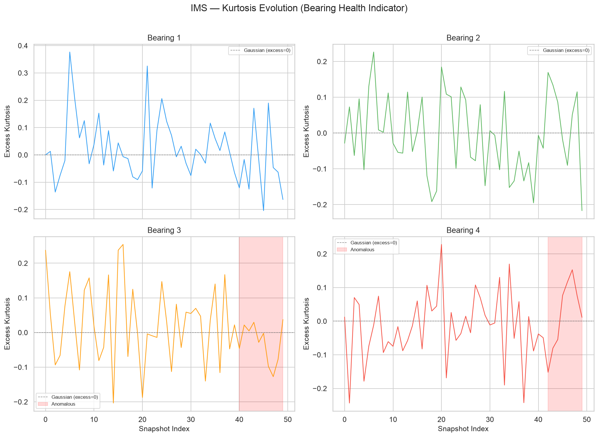
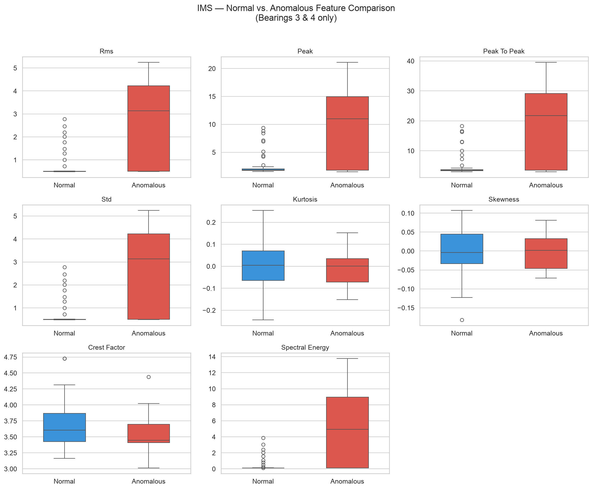
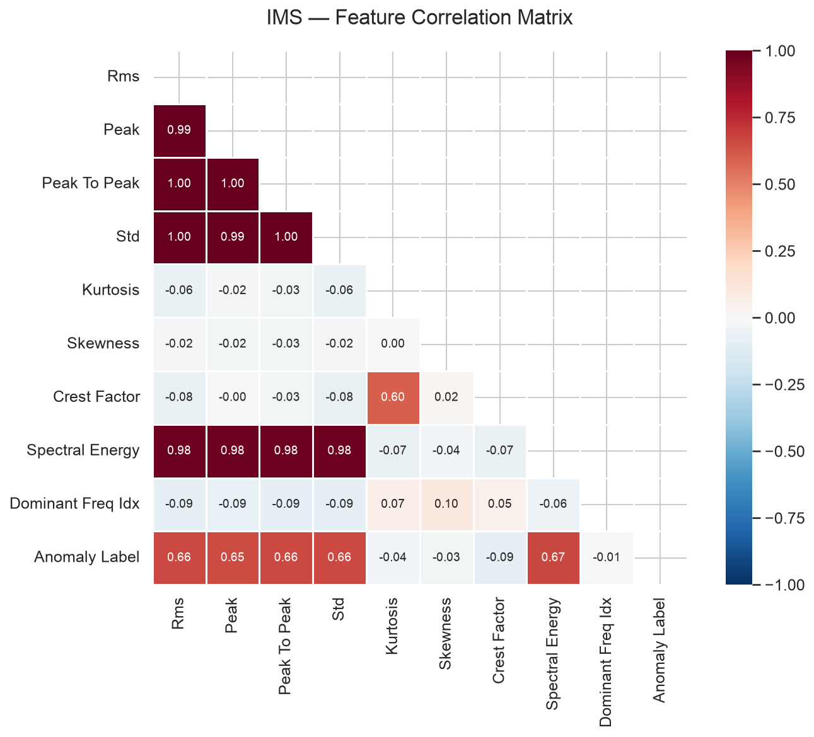

# IMS Bearing — Exploratory Data Analysis

## Dataset Overview

| Metric | Value |
|--------|-------|
| Total Rows | 200 |
| Total Bearings | 4 |
| Snapshots per Bearing | 50 |
| Normal Samples | 182 |
| Anomalous Samples | 18 |
| Anomaly Ratio | 9.0% |

## Per-Bearing Anomaly Breakdown

| Bearing | Total | Anomalous | Status |
|---------|-------|-----------|--------|
| Bearing 1 | 50 | 0 | ✅ Healthy |
| Bearing 2 | 50 | 0 | ✅ Healthy |
| Bearing 3 | 50 | 10 | ⚠️ Failure |
| Bearing 4 | 50 | 8 | ⚠️ Failure |

## Vibration Feature Statistics

| Feature | Mean | Std | Min | Max |
|---------|------|-----|-----|-----|
| Rms | 0.7391 | 0.8551 | 0.4806 | 5.2476 |
| Peak | 2.6803 | 3.0414 | 1.5050 | 21.1114 |
| Peak To Peak | 5.1049 | 5.8804 | 2.9740 | 39.5543 |
| Std | 0.7389 | 0.8549 | 0.4806 | 5.2463 |
| Kurtosis | 0.0051 | 0.1097 | -0.2435 | 0.3765 |
| Skewness | 0.0045 | 0.0600 | -0.1819 | 0.1487 |
| Crest Factor | 3.6598 | 0.3813 | 3.0140 | 4.9999 |
| Spectral Energy | 0.6377 | 2.0686 | 0.1155 | 13.7767 |
| Dominant Freq Idx | 504.9700 | 295.1019 | 4.0000 | 1015.0000 |

## Visualizations

### Vibration RMS Trends

### Spectral Energy Progression

### Kurtosis Evolution

### Normal vs. Anomalous Comparison

### Feature Correlation

## Key Observations

1. **Bearing 3 (outer race failure)**: Shows clear vibration RMS increase and kurtosis spikes in the final 20% of the test, consistent with documented outer race defect progression.
2. **Bearing 4 (rolling element failure)**: Exhibits rolling element damage signatures in the final 15% with increasing spectral energy.
3. **Bearings 1 & 2 (healthy)**: Maintain stable vibration characteristics throughout the test — no anomalous labels assigned.
4. **Class imbalance**: Only 9.0% of samples are anomalous, requiring careful handling during model training (e.g., weighted loss, SMOTE, or anomaly-detection-native approaches like autoencoders).
5. **Kurtosis as early warning**: Kurtosis deviations often precede RMS changes, suggesting it could serve as an early degradation indicator.
